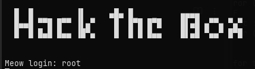

# Meow



This was my first hands-on approach to the concepts I've researched about so far.
The solution to this machine was fairly simple, it had a telnet open port which enabled logging in as root directly with generic credentials.

### **Connecting to the machine**

HTB features a virtual machine in their platform directly (PwnBox), but I decided to connect from my own VM using OpenVPN (important to run with sudo). This allows you to be on the same network as the machine you're playing on.

### **Enumeration**

Enumeration is the process of probing the target for access, open ports, versions, etc. Basically doing active and direct reconnaissance, analyzing the responses from the target.

My first step was to run an nmap (network map) scan on the machine to check for open ports and do research on vulnerabilities.

```
nmap -sC -sV [target_ip]
```
This scan returned 999 closed ports, with the only port listening on 23 (telnet).

### **Telnet**

Telnet is a network protocol for remote access which is text-based. It got replaced by SSH and is a legacy protocol. This is an obvious vulnerability as it's not only less secure, it's also more susceptible to attacks like packet sniffing and MITM.

In this case my first instinct was to try and connect using telnet:

```
telnet [target_ip] 23
```
23 being the port.

I was prompted for a login, so I first tried "admin" with no success. I tried "root" after which gave me access since it had a blank password.

With that I had access to the system on root privileges, allowing me to get the flag on the home directory.

### Takeaways

Although this was a very easy machine, it gave me insights on how real enumeration works and the process of researching a vulnerability once you find it. It also reminded me of how common it is to leave generic credentials on services.
A fix to this would be using ssh with secure credentials. Although it was easy access, logging in like this isn't stealthy. A SIEM would pick up the log and flag it.
