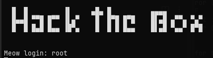

# Meow



This was my first hands-on approach to the concepts I've researched so far.
The solution to this machine was fairly simple, it had telnet open on port 23 which allowed logging in as root directly with no password.

### **Connecting to the machine**

HTB features a virtual machine in their platform directly (PwnBox), but I decided to connect from my own VM using OpenVPN (important to run with sudo, since it needs root to create the tunnel interface). This allows you to be on the same network as the machine you're playing on.

```
sudo openvpn [starting_point_vpn].ovpn
```

A quick `ping [target_ip]` is a good way to check the connection is working before starting.

### **Enumeration**

[Enumeration](../../knowledge/Enumeration.md) is the process of probing the target for access, open ports, versions, etc. Basically doing active and direct reconnaissance, analyzing the responses from the target.

My first step was to run an [nmap](../../knowledge/nmap.md) (Network Mapper) scan on the machine to check for open ports and do research on vulnerabilities.

```
nmap -sC -sV [target_ip]
```
This scan returned 999 closed ports, with the only open port being 23 (telnet). By default nmap only scans the 1000 most common ports, so on harder machines it's worth also running a full scan to make sure nothing is missed.

### **Telnet**

[Telnet](../../knowledge/Telnet.md) is a network protocol for remote access which is text-based. It got replaced by SSH and is a legacy protocol. Having it exposed is a red flag since everything  is sent in plaintext through this protocol, so it's more susceptible to attacks. The actual vulnerability in this machine though was the misconfiguration behind it, a root account with a blank password.

In this case my first instinct was to try and connect using telnet:

```
telnet [target_ip] 23
```
23 being the port (telnet default).

I was prompted for a login, so I first tried "admin" with no success. I then tried "root", which gave me access since it had a blank password.

With that I had access to the system with root privileges, allowing me to get the flag in root's home directory (`/root`).

### Takeaways

Although this was a very easy machine, it gave me insights on how real enumeration works and the process of researching a vulnerability once you find it. It also reminded me of how common it is to leave generic/default credentials on services.
Since I landed directly as root, there was no privilege escalation step needed here, which won't be the case on most machines.
A fix to this would be disabling telnet and using SSH instead, with a strong password (or key-based auth) on root and direct root login disabled. Although it was easy access, logging in like this isn't quiet. The login gets recorded in the system's auth logs, and if those are forwarded to a SIEM, a root login over telnet would very likely get flagged.
